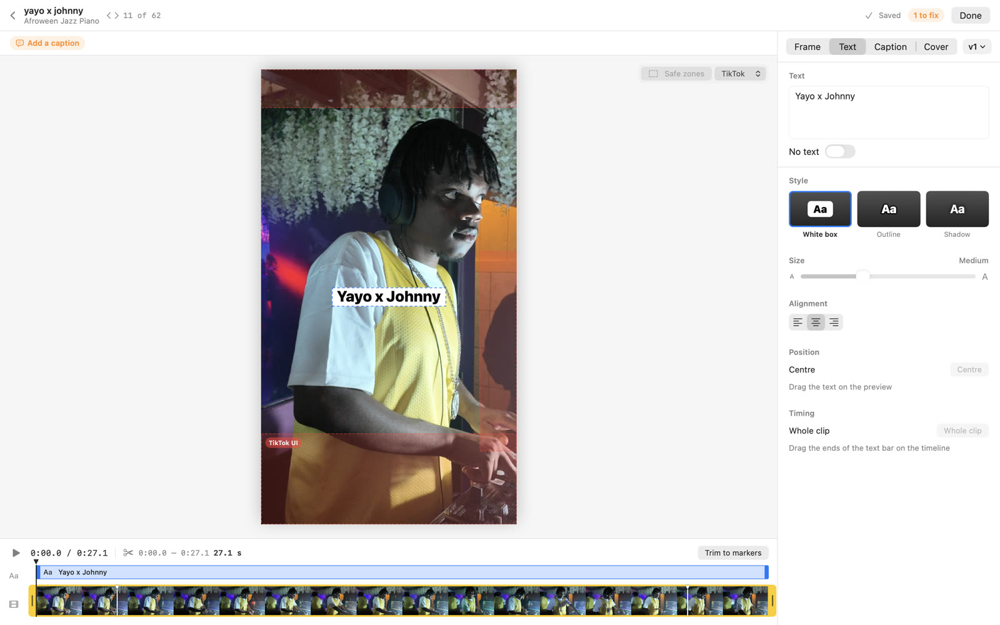
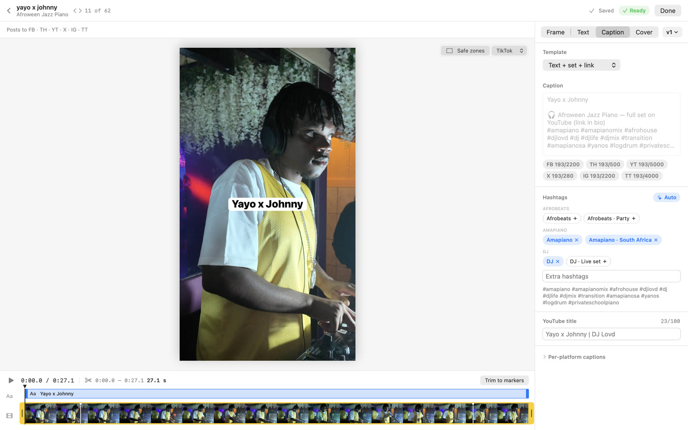
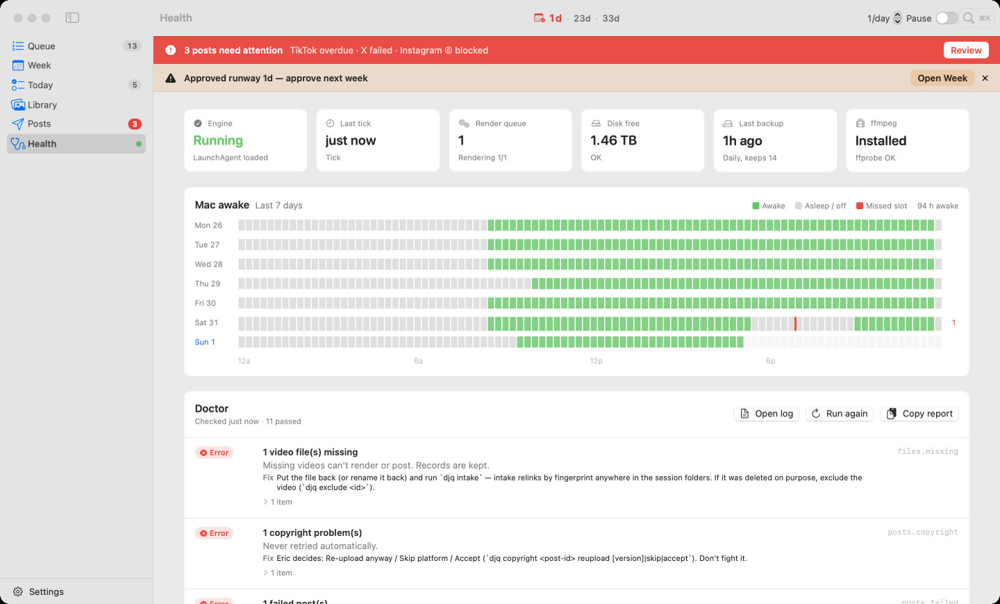
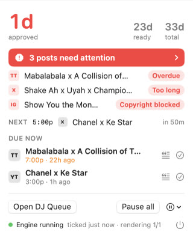
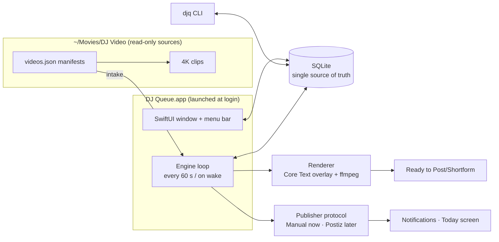

# DJ Queue

A native macOS app that runs my DJ content pipeline: it turns raw 4K clips from a DJ set into vertical short-form videos, plans what posts where and when across six platforms, renders the final files in the background, and tracks every post — including missed slots, failures and copyright blocks.

Built for my own use as DJ Lovd (TikTok, Instagram, Facebook, YouTube Shorts, Threads, X). SwiftUI + AVFoundation + SQLite + ffmpeg, ~18k lines, 142 automated tests. Designed, specified and shipped in one day with a team of AI coding agents that I directed — see [How it was built](#how-it-was-built).


## What it does

- **Intake** — watches my session folders; every clip exported from my CapCut markers shows up automatically. Renamed files are re-found by content fingerprint; deleted files are flagged, never lost.
- **Score & queue** — I score each clip 0–100; the queue orders the backlog worst → best (to warm up new accounts) or best → worst.
- **Vertical editor** — crop a 4K 16:9 frame to 9:16, trim to my original markers, add overlay text (prefilled from the clip's tag), captions with per-platform character limits and auto hashtags, a cover frame, and versions for reposts.
- **Weekly approval** — the app proposes the next 7 days; I drag, swap, pin and approve. Only approved weeks ever post.
- **Background engine** — runs at login, renders the approved week ahead of time (1080×1920 H.264, loudness-normalised to −14 LUFS), and notifies me when each platform post is due.
- **Manual publisher (phase 1)** — a Today screen: drag the file into the upload page, copy the platform-specific caption, mark posted with the URL. Built behind a `Publisher` interface so an API publisher (Postiz) can replace it later without touching the rest.
- **Failure handling** — missed slots shift that platform's plan without ever double-posting; failed posts re-queue the next day after a fix; copyright blocks are shown loudly and never auto-retried.
- **Doctor** — `djq doctor` checks everything (manifests, missing files, renders, overdue posts, runway, DB integrity, disk, tools) and prints a report an AI agent can act on, paired with a skill that documents the safe fix for every finding.

| Editor — text | Editor — captions |
|---|---|
|  |  |
| **Week** | **Today** |
|  |  |
| **Health** | **Menu bar** |
|  |  |

## Architecture



- **One process, three roles.** A LaunchAgent starts the app in agent mode at login; the same process hosts the engine loop, the menu-bar item and (on demand) the main window. macOS only delivers notifications from an app bundle, which drove this design. A file lock guarantees one engine per database; the CLI shares the same WAL-mode SQLite file.
- **Core library (`DJQCore`)** holds everything testable: models, store, intake, validation, captions, planner, engine, renderer, Doctor. The app and the CLI are thin shells over it.
- **Data model.** Videos (identity from the manifest; app-owned fields like score are never overwritten by intake), edits, text versions with carry-forward, weekly plans, and platform posts with an append-only history. A fix or repost creates a new attempt; history is never rewritten.

## Engineering highlights

- **Preview equals export.** Overlay text (including colour emoji) is rendered once with Core Text into a transparent PNG; the editor draws that exact image over the player and ffmpeg composites the same image into the final video. Measured difference between the editor preview and a frame grabbed from the rendered MP4: ~1.5/255 (codec noise).

  
  *Editor preview (left), frame from the exported MP4 (middle), difference ×8 (right).*

- **Loudness.** Two-pass EBU R128 normalisation so a phone-mic clip and a clean desk-feed clip play at the same volume (−11.2 and −13.2 LUFS sources → −14.1 LUFS both, true peak ≤ −1 dBTP).
- **Never double-post.** Every planner operation (approve, swap, move, push, skip, reset, missed-day shifts) goes through one placement rule; an invariant check runs after every operation in the tests, and a reviewer fuzzed 80 × 60 random operations with zero violations.
- **Time is hard.** Slots are scheduled in America/New_York; a reviewer-found bug where every slot was an hour off on the DST change day is covered by a test.
- **Crash-safe background work.** Kernel `flock` per render plus atomic status claims, so the app and the CLI can't render the same file; ffmpeg timeouts; failed renders back off instead of starving the queue.
- **Never touch source footage.** The app writes only to its own output folders; enforced in review and checked in the final acceptance run.

## How it was built

I wrote the product spec, then directed AI coding agents (Claude Code) through a structured process I use for larger builds:

1. **Design before code** — an inventory of every screen, control and state (~110 slots), a locked visual reference per slot, and one decision page with 28 product/design questions and pictures (text styles rendered on real frames from my footage). I answered once; the answers became binding (`DECISIONS.md`).
2. **Contracts, then parallel work** — a foundation layer and an API contract (`ARCHITECTURE.md`), then four agents building in parallel on separate branches with disjoint file ownership: renderer, engine + CLI + Doctor, main UI, editor.
3. **Independent review on every branch** — a fresh reviewer agent per milestone checked spec fidelity and code quality, with probes. Real bugs caught this way: a double-post path after a missed day, an edit hash that would have re-rendered and overwritten files whenever a platform was toggled, a DST off-by-an-hour, trim handles that stuck, crop maths 1 px off the export.
4. **Integration and a final end-to-end review** against the spec's acceptance criteria on my real clips, with screenshots of every screen beside its reference, then ship.

The commit history shows that flow (`Co-Authored-By` lines mark agent-written commits). Design artifacts are in `design/` (`INVENTORY.md`, `DESIGN.md`, `REFS.md`, text-style mockups) and the decision page is `DECISIONS.html` (its third-party reference images aren't published).

## Run it

Requires macOS 15+, a Swift 6 toolchain (Xcode or Command Line Tools) and `ffmpeg` (`brew install ffmpeg`).

```bash
swift build && swift test                  # 142 tests
scripts/build-app.sh                       # builds "build/DJ Queue.app" with the djq CLI inside
scripts/build-app.sh --install             # copies to ~/Applications and links ~/bin/djq
```

The app reads session folders at `~/Movies/DJ Video/Sessions/<date – name>/videos.json` (written by my CapCut export scripts). To run against a scratch copy instead of real data, set `DJQ_ROOT` (the "DJ Video" folder) and `DJQ_HOME` (database and logs) and launch the binary inside the bundle directly. `DJQueueApp --snapshot <dir>` renders every screen in light and dark.

## Layout

```
Sources/DJQCore/        core library — models, store, intake, captions, validation
  Render/               Core Text overlay, media helpers, ffmpeg renderer
  Engine/               queue, planner, scheduling, post actions, engine loop, Doctor
Sources/djq/            CLI
Sources/DJQueueApp/     SwiftUI app — queue, week, today, library, posts, health, settings, editor, menu bar
Tests/DJQCoreTests/     Swift Testing suite
skills/                 Claude skill for the Doctor report
design/                 inventory, design spec, mockups
```

## Status

Phase 1 (manual publishing) is in daily use. Next: a Postiz publisher so posts go out with the Mac off, then analytics and opt-in reposting of underperforming posts.

## License

MIT — see [LICENSE](LICENSE).
